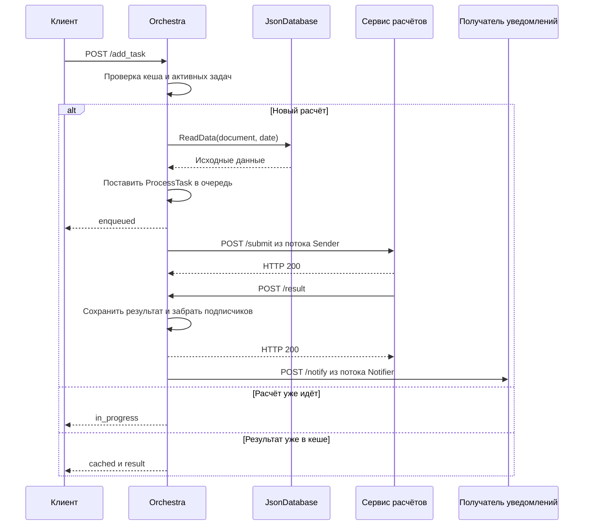

# CI-CD

Orchestra принимает заявки на вычисления, подготавливает исходные данные и передаёт задачи внешнему сервису. Внешний сервис подтверждает приём задачи, а по завершении возвращает результат отдельным HTTP-запросом. Orchestra сохраняет успешные результаты в кеше и отправляет уведомления ожидающим пользователям.

## Сборка и запуск

Понадобятся CMake 3.20 или новее, компилятор с поддержкой C++23 и Git. Выполните из корня репозитория.

```bash
cmake -S . -B build -DCMAKE_BUILD_TYPE=Debug
cmake --build build --config Debug --target orchestra
```

Перед запуском подготовьте JSON-файл с исходными данными. По умолчанию Orchestra ищет `data.json` в рабочем каталоге. Путь можно задать через `ORCHESTRA_DATA_FILE`.

```bash
ORCHESTRA_DATA_FILE=./data.json ./build/bin/debug/orchestra 127.0.0.1 8080 \
  http://127.0.0.1:9000 /submit \
  http://127.0.0.1:9000 /notify
```

Первые два аргумента задают адрес и порт Orchestra. Следующие два задают адрес и путь вычислительного сервиса. Последняя пара включает HTTP-уведомления и задаёт адрес и путь их получателя. Если последняя пара опущена, уведомления выводятся в консоль Orchestra.

## Как проходит заявка



### 1. HTTP-сервер, Maker и дедупликация

Клиент отправляет `POST /add_task` с JSON. Поля `author`, `date`, `document` и `process` обязательны и имеют строковый тип. `id` — необязательный идентификатор заявки, который вернётся в `request_id`.

`CalculateRequestMaker` строит ключ расчёта `dedup_key` из `process`, `document` и `date` в этом порядке. Ключ — строка с JSON-массивом, например `["calculate-risk","portfolio","2026-11-25"]`. Поэтому заявки от разных авторов с разными `id` могут относиться к одному расчёту.

Maker сначала ищет результат в `ExternalResponseCache`. Если результата пока нет, он регистрирует автора в потокобезопасном `RecipientList`. Для уже активного ключа реестр добавляет автора в список ожидающих. Для нового ключа Maker повторно проверяет кеш, чтобы учесть расчёт, который мог завершиться между первой проверкой и регистрацией, затем читает исходные данные и ставит `ProcessTask` в очередь.

| `status` | `enqueued` | Что получает клиент |
| --- | --- | --- |
| `enqueued` | `true` | Подтверждение, что новая задача добавлена в очередь. |
| `in_progress` | `false` | Подтверждение подписки на существующий расчёт. |
| `cached` | `false` | Готовые данные в поле `result`. |
| `failed` | `false` | Причину ошибки в поле `error`, например отсутствие исходных данных. |

Эти ответы имеют код `HTTP 200`. Некорректное тело запроса даёт `HTTP 400` и `status: invalid_request`.

### 2. Исходные данные и `JsonDatabase`

Maker читает данные через интерфейс `IDataReader`. В `main` к нему подключён `JsonDatabase`. Компонент читает файл при обращении и ищет запись по паре `document` и `date`. Файл содержит JSON-массив записей, а вычислительные поля каждой записи находятся в объекте `content`.

```json
[
  {
    "document": "portfolio",
    "date": "2026-11-25",
    "content": {
      "portfolio_sum": 30000
    }
  }
]
```

Для найденной записи `JsonDatabase` возвращает поля `content` и добавляет в них `doc` и `date` из записи. Именно этот объект попадает в `input_data`. Например, при чтении записи выше Sender передаст `{"doc":"portfolio","date":"2026-11-25","portfolio_sum":30000}`. Поля `document` и `date` на уровне записи используются для поиска. Дополнительные поля из `content` сохраняются в `input_data`.

Если записи нет или файл повреждён, Maker возвращает `failed`, удаляет регистрацию новой задачи и пропускает постановку в очередь. После исправления данных запрос можно повторить. Успешные расчёты продолжают возвращаться из кеша по тому же ключу до перезапуска процесса.

### 3. Очередь и `CalculateServiceSender`

`ProcessTask` содержит исходную заявку, ключ расчёта и входные данные. Maker кладёт новую задачу в одну из двух очередей `PriorityQueue` по полю `priority` заявки. Значение `manual` задаёт высокий приоритет и используется по умолчанию. Значение `auto` задаёт низкий приоритет.

Перед каждой отправкой Sender сначала проверяет очередь высокого приоритета. Когда она пуста, он берёт задачу из очереди низкого приоритета. Внутри каждой очереди действует порядок поступления. Текущий POST завершается перед выбором следующей задачи.

Sender передаёт каждую задачу на заданный при запуске HTTP-маршрут. В теле POST передаются `dedup_key`, `input_data` и `name_process`.

```json
{
  "dedup_key": "[\"calculate-risk\",\"portfolio\",\"2026-11-25\"]",
  "input_data": {
    "doc": "portfolio",
    "date": "2026-11-25",
    "portfolio_sum": 30000
  },
  "name_process": "calculate-risk"
}
```

`HTTP 200` от вычислительного сервиса подтверждает приём задачи. Другие статусы и ошибки соединения Sender пишет в лог. Повторные попытки отправки автоматически не выполняются. Пока callback не поступил, задача остаётся активной и повторная заявка получает `in_progress`.

### 4. Callback, кеш и список подписчиков

После завершения расчёта внешний сервис отправляет `POST /result` в Orchestra. Поле `key` должно совпадать с `dedup_key` из запроса Sender. Поля `key` и `status` должны быть непустыми строками.

- При успешном статусе, например `Approve`, `ExternalResponseHandler` сохраняет весь JSON callback в `ExternalResponseCache`, извлекает подписчиков и передаёт результат в Notifier. Следующий запрос с тем же ключом получает `cached` и результат в поле `result`.
- При `status: failed` callback должен содержать строковое поле `error`. Обработчик извлекает подписчиков и передаёт ошибку в Notifier. Снятие активной записи позволяет повторить расчёт.

Корректный callback получает `HTTP 200`, а ошибка формата — `HTTP 400`. Кеш результатов, список подписчиков и обе очереди находятся в памяти процесса. Исходные данные хранятся в JSON-файле.

### 5. `Notifier` и получение результата

`ExternalResponseHandler` передаёт всех подписчиков одного расчёта одним вызовом `NotifyBatch`. Вызов помещает сообщение в очередь, а фоновый поток Notifier собирает JSON и отправляет POST на конечный адрес. В режиме HTTP получатель увидит, например, такое сообщение.

```json
{
  "список получателей": ["alice", "bob"],
  "document": "portfolio",
  "date": "2026-11-25",
  "operation": "calculate-risk",
  "result": {
    "key": "[\"calculate-risk\",\"portfolio\",\"2026-11-25\"]",
    "status": "Approve",
    "risk_score": 0.75
  }
}
```

При ошибке расчёта `result` содержит `status: failed` и `error`. Получатель подтверждает доставку кодом `2xx`. Ошибки доставки записываются в лог. Клиент также может получить готовый результат, повторив `POST /add_task` с теми же процессом, документом и датой.

## Проверка

В [TEST.md](TEST.md) приведён сквозной сценарий с Python-приёмником на стандартной библиотеке. Он показывает чтение JSON-базы, исходящий запрос Sender, групповой POST от Notifier, попадание в кеш и ответ при отсутствующей записи.

Для автоматического расчёта в репозитории есть `service/fake_server.py`. Он принимает тот же JSON на `POST /submit` и подтверждает приём сразу. Через пять секунд он вычисляет `risk_score = portfolio_sum / (portfolio_sum + 10000)` по числовому полю `input_data.portfolio_sum` и отправляет результат по адресу `ORCHESTRA_CALLBACK_URL`. По умолчанию используется `http://127.0.0.1:8080/result`.

В активированном виртуальном окружении выполните из корня репозитория.

```bash
python3 -m pip install fastapi httpx uvicorn
python3 -m uvicorn service.fake_server:app --host 127.0.0.1 --port 9000
```
