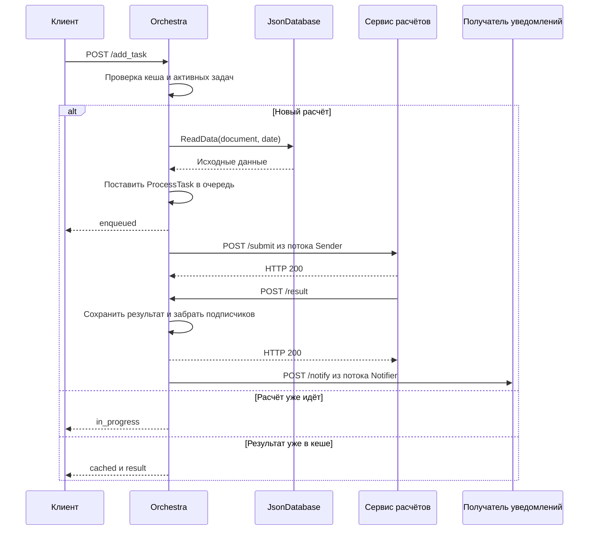

# CI-CD

Orchestra принимает заявки на вычисления, подготавливает исходные данные и передаёт задачи внешнему сервису. Внешний сервис подтверждает приём задачи, а по завершении возвращает результат отдельным HTTP-запросом. Orchestra сохраняет успешные результаты в кеше и отправляет уведомления ожидающим пользователям.

## Сборка и запуск

Понадобятся CMake 3.20 или новее, компилятор с поддержкой C++23 и Git. Выполните из корня репозитория.

```bash
cmake -S . -B build -DCMAKE_BUILD_TYPE=Debug
cmake --build build --config Debug --target orchestra
```

Перед запуском подготовьте JSON-файл с исходными данными. По умолчанию Orchestra ищет `data.json` в рабочем каталоге. Путь можно задать через `ORCHESTRA_DATA_FILE`.

```bash
ORCHESTRA_DATA_FILE=./data.json ./build/bin/debug/orchestra 127.0.0.1 8080 \
  http://127.0.0.1:9000 /submit \
  http://127.0.0.1:9000 /notify
```

Первые два аргумента задают адрес и порт Orchestra. Следующие два задают адрес и путь вычислительного сервиса. Последняя пара включает HTTP-уведомления и задаёт адрес и путь их получателя. Если последняя пара опущена, уведомления выводятся в консоль Orchestra.

Путь к JSON-конфигурации загрузки можно передать через `ORCHESTRA_CONFIG_FILE`. Ниже указаны значения по умолчанию. Поля можно переопределять по одному.

```json
{
  "max_concurrent_requests": 4,
  "request_timeout_ms": 300000,
  "cancel_path": "/cancel"
}
```

## Как проходит заявка



### 1. HTTP-сервер, Maker и дедупликация

#### `POST /add_task` — клиент → Orchestra

Тело запроса.

```json
{
  "id": "demo-1",
  "author": "alice",
  "date": "2026-11-25",
  "document": "portfolio",
  "process": "calculate-risk",
  "priority": "manual"
}
```

Поля `author`, `date`, `document` и `process` обязательны и имеют строковый тип. `id` — необязательный идентификатор заявки, который вернётся в `request_id`. Без `id` сервис возвращает пустую строку. Необязательное поле `priority` по умолчанию равно `manual`. Клиент также может передать строку `create_at` с отметкой времени.

`CalculateRequestMaker` строит ключ расчёта `dedup_key` из `process`, `document` и `date` в этом порядке. Ключ — строка с JSON-массивом, например `["calculate-risk","portfolio","2026-11-25"]`. Поэтому заявки от разных авторов с разными `id` могут относиться к одному расчёту.

Maker сначала ищет результат в `ExternalResponseCache`. Если результата пока нет, он регистрирует автора в потокобезопасном `RecipientList`. Для уже активного ключа реестр добавляет автора в список ожидающих. Для нового ключа Maker повторно проверяет кеш, чтобы учесть расчёт, который мог завершиться между первой проверкой и регистрацией, затем читает исходные данные и ставит `ProcessTask` в очередь.

| `status` | `enqueued` | Что получает клиент |
| --- | --- | --- |
| `enqueued` | `true` | Подтверждение, что новая задача добавлена в очередь. |
| `in_progress` | `false` | Подтверждение подписки на существующий расчёт. |
| `cached` | `false` | Готовые данные в поле `result`. |
| `failed` | `false` | Причину ошибки в поле `error`, например отсутствие исходных данных. |

Эти ответы имеют код `HTTP 200`. Некорректное тело запроса даёт `HTTP 400` и `status: invalid_request`.

Ответ при постановке в очередь.

```json
{
  "request_id": "demo-1",
  "enqueued": true,
  "status": "enqueued"
}
```

Ответ при подписке на существующий расчёт.

```json
{
  "request_id": "demo-2",
  "enqueued": false,
  "status": "in_progress"
}
```

Ответ для готового расчёта содержит исходный JSON от вычислительного сервиса в поле `result`.

```json
{
  "request_id": "demo-1",
  "enqueued": false,
  "status": "cached",
  "result": {
    "key": "[\"calculate-risk\",\"portfolio\",\"2026-11-25\"]",
    "attempt_id": "2741915-3975313-1",
    "status": "Approve",
    "risk_score": 0.75
  }
}
```

Ответ `HTTP 200` при ошибке подготовки расчёта.

```json
{
  "request_id": "demo-3",
  "enqueued": false,
  "status": "failed",
  "error": "No input data for document 'portfolio' on 2026-11-25"
}
```

Тело ответа `HTTP 400`.

```json
{
  "enqueued": false,
  "status": "invalid_request"
}
```

### 2. Исходные данные и `JsonDatabase`

Maker читает данные через интерфейс `IDataReader`. В `main` к нему подключён `JsonDatabase`. Компонент читает файл при обращении и ищет запись по паре `document` и `date`. Файл содержит JSON-массив записей, а вычислительные поля каждой записи находятся в объекте `content`.

```json
[
  {
    "document": "portfolio",
    "date": "2026-11-25",
    "content": {
      "portfolio_sum": 30000
    }
  }
]
```

Для найденной записи `JsonDatabase` возвращает поля `content` и добавляет в них `doc` и `date` из записи. Именно этот объект попадает в `input_data`. Например, при чтении записи выше Sender передаст `{"doc":"portfolio","date":"2026-11-25","portfolio_sum":30000}`. Поля `document` и `date` на уровне записи используются для поиска. Дополнительные поля из `content` сохраняются в `input_data`.

Если записи нет или файл повреждён, Maker возвращает `failed`, удаляет регистрацию новой задачи и пропускает постановку в очередь. После исправления данных запрос можно повторить. Успешные расчёты продолжают возвращаться из кеша по тому же ключу до перезапуска процесса.

### 3. Очередь и `CalculateServiceSender`

#### `GET /queue` — интерфейс → Orchestra

Запрос отправляется без тела. Ответ `HTTP 200` содержит снимок ожидающих задач.

```json
{
  "keys": [
    "[\"calculate-risk\",\"portfolio\",\"2026-11-25\"]"
  ]
}
```

В массиве `keys` находятся строки `dedup_key` в порядке отправки на момент снимка. Сначала идут задачи `manual`, затем `auto`, внутри каждой группы сохраняется порядок поступления. Если задач нет, ответ содержит `{"keys":[]}`. Когда Sender забирает задачу, её ключ исчезает из следующих снимков.

#### `POST /submit` — Orchestra → вычислительный сервис

`ProcessTask` содержит исходную заявку, ключ расчёта и входные данные. Maker кладёт новую задачу в одну из двух очередей `PriorityQueue` по полю `priority` заявки. Значение `manual` задаёт высокий приоритет и используется по умолчанию. Любая другая строка, включая `auto`, задаёт низкий приоритет.

Перед каждой отправкой Sender сначала проверяет очередь высокого приоритета. Когда она пуста, он берёт задачу из очереди низкого приоритета. Внутри каждой очереди действует порядок поступления. Текущий POST завершается перед выбором следующей задачи.

Перед извлечением задачи из очереди Sender ждёт свободного слота в `LoadChecker`. Перед POST он занимает слот и сохраняет время отправки. Время ожидания в очереди не входит в таймаут расчёта.

Sender передаёт каждую задачу на заданный при запуске HTTP-маршрут. POST содержит `dedup_key`, `input_data`, `name_process` и уникальный `attempt_id`.

```json
{
  "dedup_key": "[\"calculate-risk\",\"portfolio\",\"2026-11-25\"]",
  "attempt_id": "2741915-3975313-1",
  "input_data": {
    "doc": "portfolio",
    "date": "2026-11-25",
    "portfolio_sum": 30000
  },
  "name_process": "calculate-risk"
}
```

`HTTP 200` от вычислительного сервиса подтверждает приём задачи. При другом HTTP-статусе Sender завершает попытку с ошибкой и освобождает слот. При разрыве соединения попытка остаётся активной до callback или таймаута, поскольку сервис мог успеть принять POST.

#### `POST /cancel` — Orchestra → вычислительный сервис

`CalculateCanceler` проверяет время активных попыток примерно каждые 50 мс, когда нет отмен в работе. Для просроченной попытки он отправляет POST на `cancel_path` вычислительного сервиса. Путь по умолчанию — `/cancel`.

```json
{
  "dedup_key": "[\"calculate-risk\",\"portfolio\",\"2026-11-25\"]",
  "attempt_id": "2741915-3975313-1"
}
```

Код `2xx` подтверждает отмену. После попытки отмены Orchestra освобождает слот и передаёт всем ожидающим пользователям ошибку `Calculation timed out`. При ошибке запроса отмены вычислительный сервис мог продолжить работу.

### 4. Callback, кеш и список подписчиков

#### `POST /result` — вычислительный сервис → Orchestra

После завершения расчёта внешний сервис отправляет `POST /result` в Orchestra. Поле `key` должно совпадать с `dedup_key` из запроса Sender. Поля `key` и `status` должны быть непустыми строками. Сервис возвращает полученный `attempt_id` строкой. Для первой попытки по ключу в текущем процессе Orchestra принимает и прежний формат callback без `attempt_id`. При повторном запуске `attempt_id` обязателен. Запоздалые и дублированные ответы получают `HTTP 200` без изменения кеша и подписок.

При успешном статусе `ExternalResponseHandler` сохраняет весь JSON в `ExternalResponseCache`, извлекает подписчиков и передаёт результат в Notifier.

```json
{
  "key": "[\"calculate-risk\",\"portfolio\",\"2026-11-25\"]",
  "attempt_id": "2741915-3975313-1",
  "status": "Approve",
  "risk_score": 0.75
}
```

При `status: failed` поле `error` обязательно. Обработчик извлекает подписчиков и передаёт ошибку в Notifier. Снятие активной записи позволяет повторить расчёт.

```json
{
  "key": "[\"calculate-risk\",\"portfolio\",\"2026-11-25\"]",
  "attempt_id": "2741915-3975313-1",
  "status": "failed",
  "error": "Undefined risk score"
}
```

Корректный callback получает `HTTP 200`, а ошибка формата — `HTTP 400`. В обоих случаях ответ без тела. Кеш результатов, список подписчиков и обе очереди находятся в памяти процесса. Исходные данные хранятся в JSON-файле.

### 5. `Notifier` и получение результата

#### `POST /notify` — Orchestra → получатель уведомлений

`ExternalResponseHandler` передаёт всех подписчиков одного расчёта одним вызовом `NotifyBatch`. Вызов помещает сообщение в очередь, а фоновый поток Notifier собирает JSON и отправляет POST на путь, заданный при запуске. В примере используется `/notify`.

```json
{
  "список получателей": ["alice", "bob"],
  "document": "portfolio",
  "date": "2026-11-25",
  "operation": "calculate-risk",
  "result": {
    "key": "[\"calculate-risk\",\"portfolio\",\"2026-11-25\"]",
    "attempt_id": "2741915-3975313-1",
    "status": "Approve",
    "risk_score": 0.75
  }
}
```

При ошибке или таймауте в поле `result` передаются статус и сообщение.

```json
{
  "список получателей": ["alice", "bob"],
  "document": "portfolio",
  "date": "2026-11-25",
  "operation": "calculate-risk",
  "result": {
    "status": "failed",
    "error": "Calculation timed out"
  }
}
```

Получатель подтверждает доставку кодом `2xx`. Ошибки доставки записываются в лог. Клиент также может получить готовый результат, повторив `POST /add_task` с теми же процессом, документом и датой.

## Интерфейсы и замена компонентов

Orchestra собирает компоненты в `main` и передаёт им зависимости через конструкторы. Там, где зависимость задана интерфейсом, можно подключить другую реализацию, сохранив контракт и HTTP API.

| Интерфейс | Текущая реализация | Что можно подключить |
| --- | --- | --- |
| `IDataReader` | `JsonDatabase` | Чтение из базы данных или внутреннего сервиса по документу и дате. |
| `IRecipientRegistry` | `RecipientList` в памяти процесса | Общее хранилище подписок с атомарной регистрацией и извлечением группы. |
| `IUserNotifier` | HTTP-компонент `Notifier` или консольный `DummyNotifier` | Другой транспорт доставки, например очередь сообщений. |
| `IResponseCache` | Чтение из `ExternalResponseCache` в Maker | Другой источник готовых результатов для Maker. Для полной замены кеша обработчику результатов нужен также интерфейс записи. |

Sender, Canceler и HTTP Notifier используют общий интерфейс жизненного цикла `AsyncComponent`. Внутренние зависимости от `PriorityQueue<ProcessTask>`, `LoadChecker` и `ExternalResponseHandler` сейчас заданы конкретными типами. Для их взаимозаменяемости понадобятся отдельные контракты. Внешний вычислительный сервис и HTTP-получатель уведомлений подключаются по заданным адресам и путям, поэтому их можно заменить реализациями с тем же HTTP-контрактом.

## Проверка

В [спецификации OpenAPI](docs/openapi.yaml) описаны маршруты Orchestra, примеры запросов и ответов, а также исходящие запросы на запуск расчёта, отмену и доставку уведомлений.

В [TEST.md](TEST.md) приведён сквозной сценарий с Python-приёмником на стандартной библиотеке. Он показывает чтение JSON-базы, исходящий запрос Sender, групповой POST от Notifier, попадание в кеш и ответ при отсутствующей записи.

Для автоматического расчёта в репозитории есть `service/fake_server.py`. Он принимает тот же JSON на `POST /submit` и подтверждает приём сразу. Через пять секунд он вычисляет `risk_score = portfolio_sum / (portfolio_sum + 10000)` по числовому полю `input_data.portfolio_sum` и отправляет результат по адресу `ORCHESTRA_CALLBACK_URL`. По умолчанию используется `http://127.0.0.1:8080/result`.

В активированном виртуальном окружении выполните из корня репозитория.

```bash
python3 -m pip install fastapi httpx uvicorn
python3 -m uvicorn service.fake_server:app --host 127.0.0.1 --port 9000
```

### `GET /stats` — клиент → тестовый вычислительный сервис

Запрос отправляется без тела. Пример ответа после одного завершённого расчёта.

```json
{
  "count_tasks": 0,
  "tasks": [],
  "count_complete_tasks": 1,
  "complete_tasks": [
    "[\"calculate-risk\",\"portfolio\",\"2026-11-25\"]"
  ]
}
```
